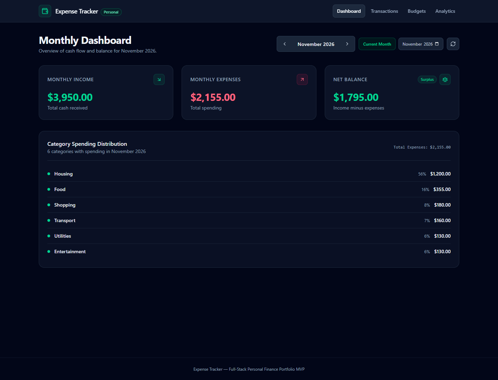
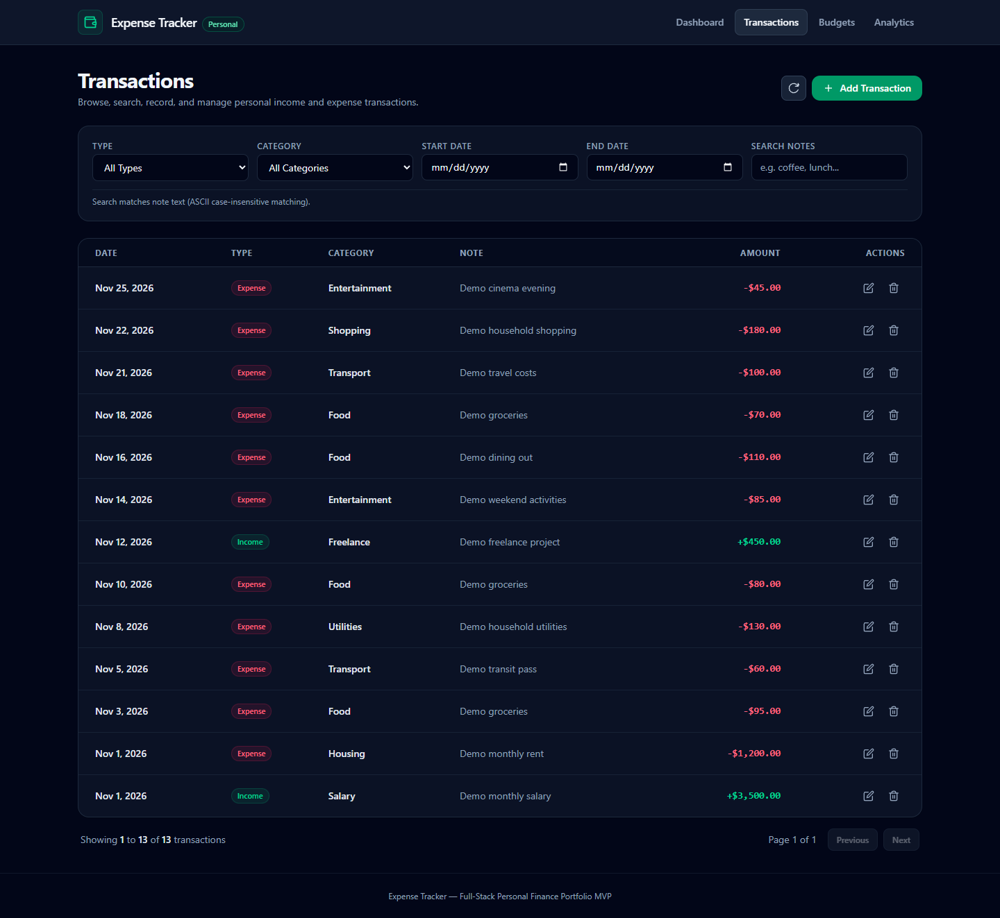
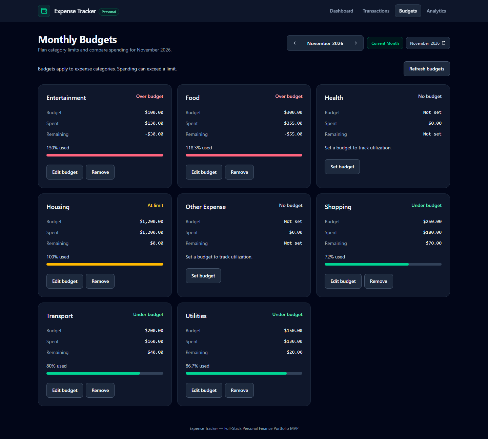
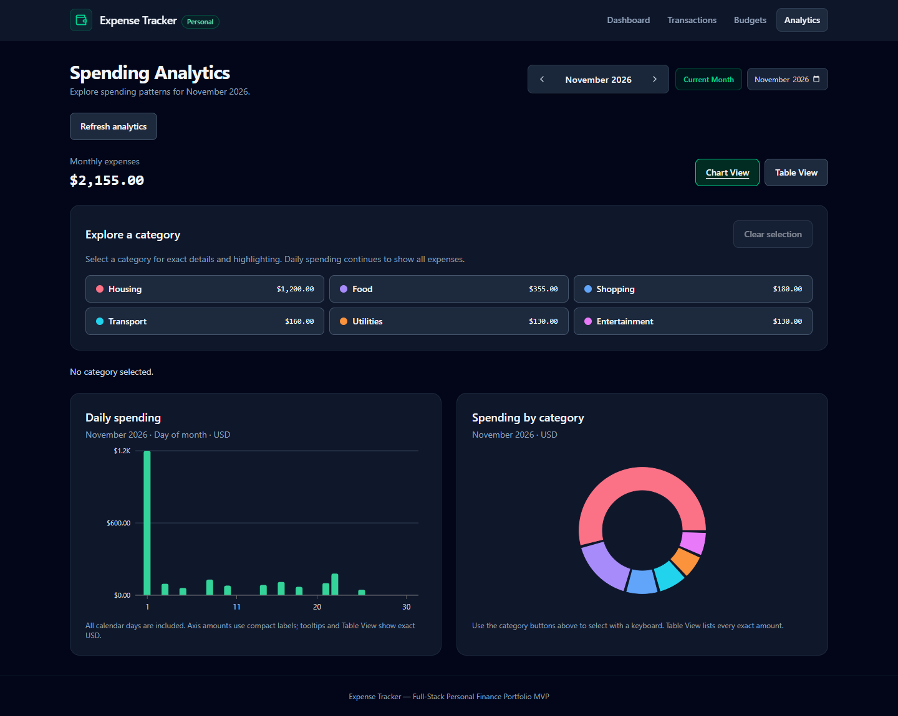

# Expense Tracker

A full-stack personal finance application built with React, TypeScript, Node.js, Express, and SQLite.

Track income and expenses, manage monthly budgets, and explore spending patterns through interactive dashboards and analytics.

### Live Demo

**[Try the Live Demo](https://expense-tracker.nhokconpero123.workers.dev/)**

**[View Source Code](https://github.com/nhokconpero123/Expense-tracker)**

### Key Features

- Monthly income, expenses, and balance dashboard
- Transaction management with search and filtering
- Category-based monthly budgets
- Interactive charts and spending analytics
- Responsive interface for desktop and mobile
- Automated frontend, backend, and browser testing

### Deployment

- **Frontend:** Cloudflare Workers Static Assets
- **Backend:** Render Web Service
- **Database:** SQLite

The public demo uses fictional financial data in a read-only, in-memory database. The original local application supports transaction and budget management.

> **Note:** The online demo is read-only. Creating, editing, and deleting records are available only in the local version.

## Features

| Area | Implemented behavior |
| --- | --- |
| Monthly Dashboard | Income, expenses, net balance, and expense-category totals for the selected month; loading, empty, error, and retry states. |
| Transactions | Create, browse, edit, and delete income/expense records with category, date, amount, and optional note. Deletion requires confirmation. |
| Search and pagination | Combine type, category, inclusive date range, and literal note search. Results sort by date descending, then ID descending; default page size is 20. |
| Monthly Budget Management | Set/edit/remove one monthly limit per expense category; compare spending, remaining amount, utilization, and textual status. Removing a limit preserves transactions. |
| Spending Analytics | Daily bar chart, category donut, category selection/details, and Chart/Table View controls. Tables expose exact values without hover; daily rows can expand from spending days to the entire month. |

Dashboard, Budgets, and Analytics share the selected month during navigation. Transaction filters are separate: the ledger is all-time until date filters are supplied, and filtering it does not change monthly totals.

Search is ASCII case-insensitive and literal for Unicode; `%`, `_`, and backslash are ordinary search characters. Full Unicode case folding and normalization are intentionally unsupported.

## Technology stack

- **Frontend:** React 19, Vite 7, strict TypeScript, Tailwind CSS 4, Recharts 3.
- **Backend:** Node.js 24, Express 5, strict TypeScript with ESM/NodeNext.
- **Storage:** SQLite through better-sqlite3 12, prepared statements, foreign keys, and versioned migrations.
- **Testing:** Vitest 5, Supertest, and a separate real-Chrome interaction test runner.
- **Tooling:** npm workspaces with one root `package-lock.json`; tsx for backend development.

Use the lockfile for exact dependency versions; `npm.cmd ci` reproduces that dependency set.

## Architecture and engineering decisions

```text
React pages and shared MonthContext
              |
       hooks / API clients
              | JSON /api via local Vite proxy
Express routes -> validation -> services -> repositories
                                                 |
                                               SQLite
```

- **Exact USD values:** money is stored and sent as integer cents. For example, `12.34` becomes `1234` without floating-point multiplication. Individual transaction/budget amounts range from $0.01 to $1,000,000.00. Backend aggregate checks reject unsafe totals; BigInt-based formatting preserves cents in large totals and negative balances.
- **One source of financial truth:** summary and budget values come from persisted transactions. The backend provides a complete, zero-filled daily series, including leap days; the frontend does not fill it again or regroup authoritative totals.
- **Explicit calendar membership:** dates use `YYYY-MM-DD`, months use `YYYY-MM`, and supported years are 1900–9999. Reporting follows the transaction date, not UTC metadata timestamps. Net balance means monthly income minus expenses, not an account balance.
- **Atomic writes and consistent reads:** services own SQLite transactions around writes, aggregate guards, and readback. Related summary queries share a read snapshot. Constraints enforce category/type relationships and unique category/month budgets.
- **Small state model:** React context shares month and transaction revision state without Redux/Zustand. Monthly loaders use request ordering and cancellation to reject obsolete responses. A successful write is distinguished from a later refresh failure.
- **Chart alternatives:** native category buttons and readable tables complement SVG/hover interactions. This does not imply every application accessibility criterion is verified; see known limitations.
- **Local deployment boundary:** the API is a separate process; it does not serve the frontend build. Vite development/preview serves the UI and proxies API requests locally.

```text
frontend/src/         Pages, components, hooks, API clients, money/date utilities
frontend/test/browser/ Isolated Chrome Analytics test entry and runner
backend/src/          Routes, validators, services, repositories, database lifecycle
backend/data/         Default local SQLite storage (Git-ignored)
docs/                 Requirements, API contract, architecture, and verification history
```

## Prerequisites

The documented setup targets **Windows PowerShell**:

- **Node.js >=24.19.0 and <25**; `.nvmrc` records `24.19.0` as the tested baseline.
- **npm >=11 and <12**; the documentation verification environment uses npm `11.17.0`.
- A browser for the application. The optional browser suite requires an installed Chrome executable.
- better-sqlite3 is a native dependency. A compatible prebuilt binary is preferred; if unavailable, installation may require a supported Windows C++/Python build toolchain. A global SQLite command-line installation is not required.

Use `npm.cmd` to avoid PowerShell blocking the `npm.ps1` shim. Do not change execution policy just to run these commands.

## Install and run in development

Clone this repository using its GitHub URL or download and extract its ZIP, then open PowerShell in the repository root (the folder containing the root package.json):

```powershell
node --version
npm.cmd --version
npm.cmd ci
if (-not (Test-Path -LiteralPath 'backend/.env')) {
    Copy-Item -LiteralPath '.env.example' -Destination 'backend/.env'
}
npm.cmd run db:init --workspace backend
npm.cmd run dev
```

The environment-file copy is optional because defaults work without it; the conditional preserves an existing file. `db:init` creates missing schema and seeds the fixed category catalog. Startup performs the same initialization, so explicitly running it first is useful but not required. No sample transactions or budgets are inserted by initialization.

Open **http://127.0.0.1:5173**. Stop development with **Ctrl+C**; the root runner stops both workspace commands. Neither listener should be exposed through a LAN address or public tunnel.

## Database initialization, migrations, and backups

The default file is `backend/data/expense-tracker.sqlite`, shared by source and compiled backend startup. A relative `DATABASE_PATH` is resolved from `backend/`, regardless of the command's working directory. An absolute path is also accepted. Empty paths and development `:memory:` storage are rejected.

`npm.cmd run db:init --workspace backend` and normal backend startup apply pending migrations and insert missing catalog entries atomically. Migration history must be compatible; initialization never resets existing records or replaces the database. There is no reset or automatic migration-down command. Do not delete the database to resolve an initialization failure.

Before schema changes or manual storage work:

1. Stop all application processes using that database and ensure its connections have closed.
2. Copy the configured SQLite file to a private, separate backup location. If SQLite journal/WAL sidecar files remain, preserve the complete file set together; do not copy only the main file from a running database.
3. Preserve the original backup. Rehearse restoration using a separate copy and an explicit `DATABASE_PATH`, rather than overwriting working records.

Backup restoration and the full compiled-server restart walkthrough remain release checks to record; these instructions are not evidence that they were completed.

Automated database tests use memory or newly allocated private temporary files. Test mode ignores the development path, rejects unmanaged file paths, and prevents development-mode access under Vitest. Persistence tests close/reopen isolated files; they do not reset development storage.

## Commands

Run all commands from the repository root.

| Command | Purpose |
| --- | --- |
| `npm.cmd ci` | Install the locked workspace dependencies; use for initial setup. |
| `npm.cmd run dev` | Run the loopback API and Vite together. |
| `npm.cmd run dev --workspace frontend` | Run Vite only. |
| `npm.cmd run dev --workspace backend` | Run the watched TypeScript API only. |
| `npm.cmd run db:init --workspace backend` | Apply pending migrations and seed missing categories; preserve records. |
| `npm.cmd run typecheck` | Check strict TypeScript in both workspaces. |
| `npm.cmd run build` | Build `frontend/dist` and compile `backend/dist`. |
| `npm.cmd test` | Run the frontend/backend Vitest suites, including Supertest integrations. |
| `npm.cmd run test:browser --workspace frontend` | Run the separate isolated Analytics Chrome suite. |
| `npm.cmd start` | Start the compiled API only; build first. |
| `npm.cmd run preview --workspace frontend` | Serve the frontend build locally; build first and run the API separately. |

For a local build preview, first run `npm.cmd run build`. Then use two PowerShell terminals at the repository root:

```powershell
# Terminal 1: compiled API
npm.cmd start
```

```powershell
# Terminal 2: frontend preview
npm.cmd run preview --workspace frontend
```

This is a local build preview, not a public production deployment. The compiled API still initializes its configured database on startup.

## Local URLs and environment

| URL | Purpose |
| --- | --- |
| `http://127.0.0.1:5173` | Vite development frontend |
| `http://127.0.0.1:4173` | Frontend build preview |
| `http://127.0.0.1:3001/api/health` | Direct API readiness: 200 when ready, otherwise 503 |
| `http://127.0.0.1:5173/api/health` | Readiness through the development proxy |
| `http://127.0.0.1:4173/api/health` | Readiness through the preview proxy when both processes run |

Frontend requests use relative `/api` URLs. Development proxies them to `http://127.0.0.1:3001`; installed Vite 7 also inherits that proxy for preview. Both frontend ports are fixed and fail if occupied. The API and frontend bind to `127.0.0.1`.

Copy the root `.env.example` to **`backend/.env`**, not the repository root. Backend scripts load it if present. Existing process environment variables take precedence.

| Setting | Default / behavior |
| --- | --- |
| `PORT` | `3001`; integer from 1 to 65535. |
| `DATABASE_PATH` | `backend/data/expense-tracker.sqlite`; configured relative values resolve from `backend/`. |

Local mode has no arbitrary HOST override. The separately opt-in hosted read-only mode and VITE_API_BASE_URL are described in [DEPLOYMENT.md](DEPLOYMENT.md); leave them unset for the original local workflow. If PORT changes, update the proxy target in `frontend/vite.config.ts` and use that API port in local URLs. Never put secrets into `VITE_*` variables: Vite exposes those values to browser code. The browser test runner separately accepts `CHROME_PATH` for a non-default Chrome installation; this is test tooling, not application configuration.

## API and reporting behavior

The base path is `/api`. Full request/response shapes, errors, and examples are in [docs/API.md](docs/API.md).

| Endpoint | Purpose |
| --- | --- |
| `GET /api/health` | Database readiness |
| `GET /api/categories` | Fixed catalog, optionally filtered by type |
| `GET /api/transactions` | Filtered/paginated list |
| `POST /api/transactions` | Create a record |
| `GET /api/transactions/:id` | Read one record |
| `PUT /api/transactions/:id` | Replace editable fields |
| `DELETE /api/transactions/:id` | Remove a record; empty 204 response |
| `GET /api/summary?month=YYYY-MM` | Income, expense, balance, category totals and daily expense series |
| `GET /api/budgets?month=YYYY-MM` | All eligible expense categories and monthly budget/spending data |
| `PUT /api/budgets/:categoryId/:month` | Create/replace a limit with `{ "amountCents": 10000 }`; returns 200 |
| `DELETE /api/budgets/:categoryId/:month` | Remove only the limit; empty 204, or 404 when absent |

Summary returns `{data:{month,incomeCents,expenseCents,balanceCents,expensesByCategory,dailyExpenses}}`. Category totals exclude income and zero-spend categories. Daily values include every calendar day, including zeros and leap days. Both breakdowns reconcile to monthly expenses.

Budgets return `{data:{month,items}}`. Each item includes category ID/name, month, amount, spent, remaining, utilization percentage, and status. Without a limit, amount/remaining/utilization are null, status is `no_budget`, and spending remains visible. With a limit, exact cents determine `under`, `at_limit`, or `over`; remaining may be negative. Utilization text may exceed 100% while progress bars are capped. Percentages are rounded display values; extremely large percentages can lose floating-point decimal resolution without changing exact cents or statuses.

## Testing strategy and evidence

- Pure tests cover decimal parsing, exact USD formatting, Gregorian dates, validation, and reporting calculations.
- Supertest and isolated SQLite tests cover real routes, constraints, rollback, aggregate safety, search semantics, snapshots, and persistence.
- Frontend tests include server-rendered components, production stores/loaders, request races, and callback/reducer behavior. Some transaction coordinator tests exercise a test-local implementation rather than mounted production behavior; they do not establish full interaction coverage.
- The separate Chrome suite mounts production Analytics, Transactions, and Budgets with deterministic intercepted responses. Its 42 interaction cases cover lifecycle transitions, keyboard/dialog behavior, pending safety, computed styles, tooltips, reduced motion, accessibility-tree semantics, and targeted responsive geometry. Two additional tests check API rejection and actual process-owned TCP listeners (44 checks total). The runner uses a dedicated loopback port, no development proxy, and records/rejects unexpected API traffic. This does not retrospectively identify three proxy attempts in an earlier audit.

The Chrome runner defaults to `C:\Program Files (x86)\Google\Chrome\Application\chrome.exe`. If needed, set its executable path for the current PowerShell session:

```powershell
$env:CHROME_PATH = 'C:\Program Files\Google\Chrome\Application\chrome.exe'
npm.cmd run test:browser --workspace frontend
```

Use a path that actually exists on your machine. The runner writes screenshots and an isolated profile to the temporary directory printed on completion; these are test artifacts, not committed portfolio screenshots. Browser cases run separately from `npm.cmd test`. Native-child TCP inspection currently requires Windows PowerShell, CIM and Get-NetTCPConnection permissions; unsupported platforms fail explicitly. Node listeners are observed continuously, while native-child listeners are checked in start/end snapshots; transient native listeners and UDP are outside this guard. The test-only BROWSER_ISOLATION_NEGATIVE=1 mode deliberately generates an unexpected blocked request and must exit nonzero.

See [docs/VERIFICATION.md](docs/VERIFICATION.md) for current command results and historical task records, [T12 verification](docs/T12_VERIFICATION.md) for budget coverage/limitations, and [T13 verification](docs/T13_VERIFICATION.md) for Analytics browser evidence. Passing tests do not imply complete accessibility or release acceptance.

## Security and scope limitations

This is an unauthenticated application for a trusted local environment. **It is not safe to deploy publicly as-is.** Do not change listener hosts, create public tunnels, or expose it on a LAN. Loopback binding is not authentication; explicit backend Host/Origin hardening remains a possible follow-up.

The backend validates requests, uses parameterized queries, limits JSON bodies, and returns sanitized errors. These controls are not a claim of production security. Keep personal databases, backups, and `.env` files private and out of Git. Never use personal records in public screenshots.

The MVP intentionally excludes authentication, multiple users, bank connections, multiple currencies, custom categories, recurring transactions, imports/exports, accounts/transfers, and budget rollover. Transaction drill-down from charts and URL month persistence are optional future enhancements. Any public demo requires a separately approved security model and isolated synthetic data.

## Known issues and remaining release work

T14c fixed the audited transaction focus, category Retry, stale rows/feedback, and month-boundary findings, with mounted interaction coverage. The later Budget Dialog focus-cycle blocker is also fixed: native modality is preserved, forward/reverse boundaries wrap locally, pending mutations block dismissal, and connected triggers or a stable heading receive restored focus.

Local MVP acceptance baseline: **399 frontend + 962 backend = 1,361 Vitest cases**; **44 Chrome checks** (42 interaction cases plus API and listener isolation checks). Typecheck and build pass. [T14d verification](docs/T14D_VERIFICATION.md) preserves the real-backend workflow, restart persistence, responsive checks, and 10,000-row measurements; those backend/query paths are unchanged.

- Historical uncertainty: the caller of three earlier summary proxy attempts remains **NOT VERIFIED**. Current isolation passes repeated normal and negative checks; this mitigates the current risk without establishing the historical source.
- Full screen-reader speech, VS Code embedded-preview acceptance, fresh-install reproducibility, and backup restoration remain unverified.
- Dashboard independently rounded category percentages can total 101%; exact USD totals remain correct.
- Portfolio screenshots below use fictional data. Explicit Host/Origin hardening is a possible follow-up; the unauthenticated API must remain local-only.

No commit, publication, or final release approval is implied by these results.

## Screenshots

These are real Chromium captures of the built application using **fictional November 2026 demo data** in a separate local SQLite database. No personal records are shown. The dataset contains 13 transactions: $3,950.00 income, $2,155.00 expenses, and a $1,795.00 balance. Groceries and dining use the existing Food category; rent uses Housing and travel uses Transport. Budgets demonstrate under budget, at limit, over budget, and no budget states.

**Monthly Dashboard**



**Transactions**



**Monthly Budgets**



**Spending Analytics**



Captured at a 1440-pixel desktop width; full-page images preserve the final rows and cards. The dedicated local database is `backend/data/portfolio-demo/portfolio-screenshots.sqlite` and remains excluded from Git. Screenshots do not imply public deployment or production security. Existing development data and `demo.sqlite` were preserved. No reusable demo-data generator is included.

## Troubleshooting

| Problem | Check or action |
| --- | --- |
| PowerShell blocks `npm.ps1` | Use `npm.cmd`; no execution-policy change is needed. |
| Unsupported Node/npm version | Check `node --version` and `npm.cmd --version`; use the supported ranges above. |
| Native SQLite install fails | Check Node compatibility, native prebuilt-binary availability, network access and the driver’s Windows build prerequisites. Do not remove the database as an installation fix. |
| Port is already in use | Stop the conflicting local process. Vite uses fixed ports. If changing API PORT, update the proxy too. |
| UI loads but data requests fail | Confirm the API is running and direct `/api/health` is ready. Check PORT/proxy consistency. Preview needs a separately running API. |
| Health returns 503 or startup fails | Check the configured database path, permissions and migration compatibility. Preserve the file and backup before investigation. |
| No category options appear | Check API/category availability. Use the category-specific Retry control after the API recovers. |
| A save succeeded but refresh failed | Retry loading; do not repeat the successful write. Successful recovery clears the obsolete refresh warning while preserving mutation-success feedback. |
| Browser suite cannot find Chrome | Set CHROME_PATH to an installed Chrome executable. This suite is optional for normal development. |
| A navigation action fails at the year boundary | Supported months are January 1900 through December 9999; boundary navigation controls are disabled. |

## Further documentation

- [Product requirements](docs/PRD.md) and [user stories](docs/USER_STORIES.md)
- [Architecture and decisions](docs/ARCHITECTURE.md)
- [API contract](docs/API.md)
- [Implementation and release plan](docs/IMPLEMENTATION_PLAN.md)
- [Verification results](docs/VERIFICATION.md)


## Prepared read-only public demo (not deployed)

The local MVP remains writable on loopback by default. A separately opt-in public-demo mode now uses fictional November 2026 data in fresh query-only in-memory SQLite, blocks HTTP mutations server-side, and provides read-only frontend controls. Hosting preparation does not authorize publication. See [DEPLOYMENT.md](DEPLOYMENT.md) for the exact Render/Cloudflare Workers Static Assets settings, explicit flags, security boundaries and required post-deployment acceptance checks. Never expose the original local writable API.


Cloudflare Workers Git builds use `npm run build:cloudflare` from the repository root after installing frontend/root workspace dependencies. The root `wrangler.json` uploads only `frontend/dist` with SPA navigation fallback; it contains no Express entry point or SQLite binding. Set the public-demo flag and Render API origin as Cloudflare build variables, and follow the exact dashboard commands and CORS prerequisite in [DEPLOYMENT.md](DEPLOYMENT.md). Build alone does not deploy.
